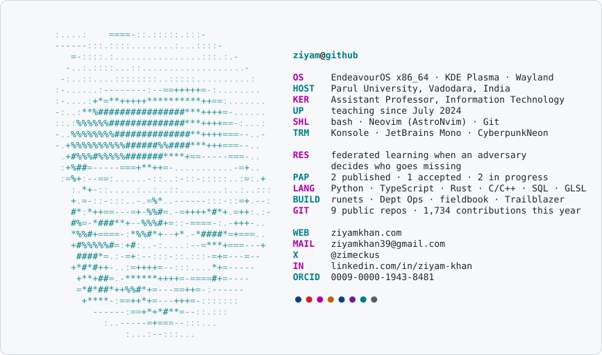

<picture>
  <source media="(prefers-color-scheme: dark)" srcset="dark.svg">
  
</picture>

  
  
  
  
  
  

**Building:** [runets](https://github.com/ziyam-khan/runets), React components and WebGL 2 shader effects · [trailblazer](https://github.com/ziyam-khan/trailblazer), a Rust file explorer
**Research:** [strategic client silence](https://github.com/ziyam-khan/research-fl-strategic-client-silence) and [adversary-aware aggregation](https://github.com/ziyam-khan/research-fl-adversary-aware-aggregation) in federated learning

The card is drawn by <a href="card.py">card.py</a> from <a href="portrait.txt">portrait.txt</a>, and a daily workflow refreshes its GitHub numbers.
